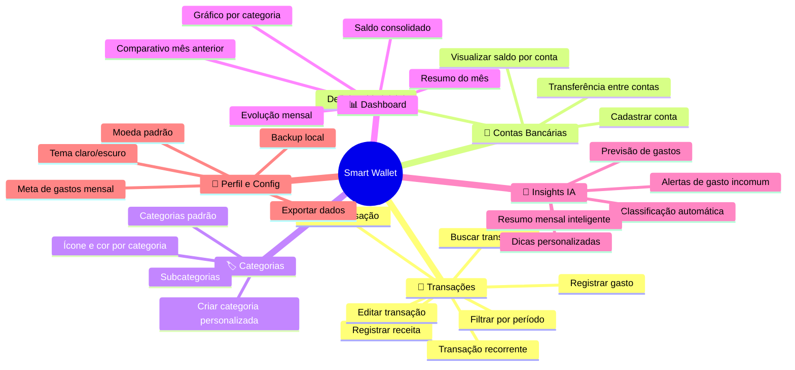
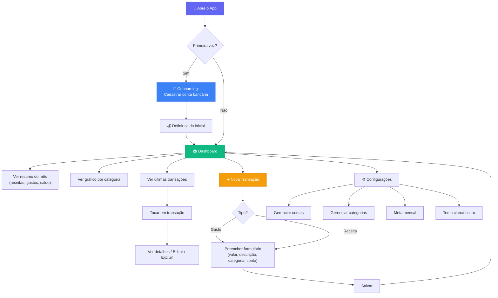

# 📋 Fase 1 — Discovery & User Stories

## 📚 Antes de Começar: O que você vai aprender aqui

### O que é uma User Story?

Uma **User Story** é a forma como a engenharia de software traduz uma necessidade do usuário em algo que o time de desenvolvimento consiga entender, priorizar e implementar.

O formato padrão é:

```
Como [persona/papel],
Quero [ação/funcionalidade],
Para [benefício/objetivo].
```

> [!TIP]
> **Por que esse formato?** Ele força você a pensar em 3 coisas: QUEM usa, O QUE faz e POR QUÊ. Se você não consegue preencher os 3, provavelmente a feature não está bem definida.

### O que são Critérios de Aceitação?

São as **condições que precisam ser verdadeiras** para que a User Story seja considerada "pronta" (Done). Eles eliminam ambiguidade e servem como base para testes.

Formato usado: **Given / When / Then** (Dado / Quando / Então)

```
DADO QUE [contexto inicial]
QUANDO [ação do usuário]
ENTÃO [resultado esperado]
```

### O que é Priorização MoSCoW?

É uma técnica para decidir o que entra no **MVP** (Minimum Viable Product):

| Prioridade | Significado | Regra |
|-----------|-------------|-------|
| **M**ust Have | Obrigatório | Sem isso, o app NÃO funciona |
| **S**hould Have | Importante | O app funciona sem, mas fica fraco |
| **C**ould Have | Desejável | Legal ter, mas pode esperar |
| **W**on't Have (now) | Futuro | Não entra no MVP, fica no backlog |

---

## 🗺️ Mapa de Funcionalidades

Antes de escrever as stories, precisamos mapear TUDO que o app pode fazer, organizado por **domínio** (área de negócio). Isso já é um pré-DDD.



---

## 📝 User Stories Completas

### Domínio: 💸 Transações

---

#### US-001 — Registrar um gasto manualmente
**Prioridade:** 🔴 Must Have

```
Como usuário,
Quero registrar um gasto informando valor, descrição, categoria e conta bancária,
Para ter controle de para onde meu dinheiro está indo.
```

**Critérios de Aceitação:**

| # | Critério |
|---|----------|
| 1 | DADO QUE estou na tela principal, QUANDO toco no botão "+", ENTÃO vejo o formulário de nova transação |
| 2 | DADO QUE estou no formulário, QUANDO preencho valor (obrigatório), descrição (opcional), categoria (obrigatório) e conta bancária (obrigatório), ENTÃO consigo salvar a transação |
| 3 | DADO QUE salvei a transação, QUANDO volto para a tela principal, ENTÃO vejo a transação na lista e o saldo atualizado |
| 4 | DADO QUE não preencho um campo obrigatório, QUANDO tento salvar, ENTÃO vejo uma mensagem de erro indicando o campo |
| 5 | DADO QUE registro um gasto, ENTÃO a data padrão é "hoje" mas posso alterar para uma data passada |

**Notas técnicas:**
- O valor deve aceitar centavos (R$ 15,90)
- O teclado numérico deve abrir automaticamente no campo valor
- A transação deve ser salva localmente (SQLite)

---

#### US-002 — Registrar uma receita
**Prioridade:** 🔴 Must Have

```
Como usuário,
Quero registrar uma receita (entrada de dinheiro),
Para que meu saldo reflita quanto tenho disponível.
```

**Critérios de Aceitação:**

| # | Critério |
|---|----------|
| 1 | DADO QUE estou no formulário de transação, QUANDO seleciono o tipo "Receita", ENTÃO o formulário muda a cor de destaque para verde |
| 2 | DADO QUE salvo uma receita, ENTÃO o saldo da conta bancária selecionada AUMENTA |
| 3 | DADO QUE salvo um gasto, ENTÃO o saldo da conta bancária selecionada DIMINUI |

---

#### US-003 — Editar uma transação existente
**Prioridade:** 🔴 Must Have

```
Como usuário,
Quero editar uma transação que registrei,
Para corrigir erros de valor, categoria ou descrição.
```

**Critérios de Aceitação:**

| # | Critério |
|---|----------|
| 1 | DADO QUE estou na lista de transações, QUANDO toco em uma transação, ENTÃO vejo os detalhes com opção de editar |
| 2 | DADO QUE edito o valor de R$50 para R$30, QUANDO salvo, ENTÃO o saldo da conta é recalculado corretamente (+ R$20) |
| 3 | DADO QUE edito a conta bancária, QUANDO salvo, ENTÃO o saldo da conta antiga é restaurado e o da nova conta é atualizado |

---

#### US-004 — Excluir uma transação
**Prioridade:** 🔴 Must Have

```
Como usuário,
Quero excluir uma transação registrada por engano,
Para manter meus registros limpos e o saldo correto.
```

**Critérios de Aceitação:**

| # | Critério |
|---|----------|
| 1 | DADO QUE estou nos detalhes de uma transação, QUANDO toco em "Excluir", ENTÃO vejo um modal de confirmação |
| 2 | DADO QUE confirmo a exclusão, ENTÃO a transação é removida e o saldo da conta é recalculado |
| 3 | DADO QUE cancelo a exclusão, ENTÃO nada muda |

---

#### US-005 — Buscar e filtrar transações
**Prioridade:** 🟡 Should Have

```
Como usuário,
Quero buscar transações por texto e filtrar por período, categoria ou conta,
Para encontrar rapidamente um gasto específico.
```

**Critérios de Aceitação:**

| # | Critério |
|---|----------|
| 1 | DADO QUE estou na lista de transações, QUANDO digito "ifood" na busca, ENTÃO vejo apenas transações cuja descrição contém "ifood" |
| 2 | DADO QUE aplico o filtro "Setembro 2026", ENTÃO vejo apenas transações desse mês |
| 3 | DADO QUE aplico o filtro categoria "Alimentação", ENTÃO vejo apenas transações dessa categoria |
| 4 | DADO QUE aplico múltiplos filtros, ENTÃO eles funcionam em combinação (AND) |

---

#### US-006 — Registrar transação recorrente
**Prioridade:** 🔵 Could Have

```
Como usuário,
Quero marcar uma transação como recorrente (mensal),
Para não precisar registrar manualmente todo mês gastos fixos como aluguel, streaming, etc.
```

**Critérios de Aceitação:**

| # | Critério |
|---|----------|
| 1 | DADO QUE estou criando uma transação, QUANDO ativo "Recorrente", ENTÃO posso definir a frequência (mensal) e o dia do mês |
| 2 | DADO QUE uma transação recorrente está configurada, QUANDO chega o dia definido, ENTÃO a transação é criada automaticamente |
| 3 | DADO QUE quero parar a recorrência, QUANDO desativo, ENTÃO nenhuma nova transação é criada |

---

### Domínio: 🏦 Contas Bancárias

---

#### US-007 — Cadastrar uma conta bancária
**Prioridade:** 🔴 Must Have

```
Como usuário,
Quero cadastrar minhas contas bancárias (Nubank, Santander, etc.),
Para separar meus gastos por banco e ter uma visão por conta.
```

**Critérios de Aceitação:**

| # | Critério |
|---|----------|
| 1 | DADO QUE acesso a área de contas, QUANDO toco em "Adicionar conta", ENTÃO vejo um formulário com nome do banco, apelido e saldo inicial |
| 2 | DADO QUE cadastro "Nubank" com saldo inicial de R$1.000, ENTÃO a conta aparece na lista com esse saldo |
| 3 | DADO QUE tenho múltiplas contas, ENTÃO vejo o saldo consolidado (soma de todas) no dashboard |

---

#### US-008 — Visualizar saldo por conta
**Prioridade:** 🔴 Must Have

```
Como usuário,
Quero ver o saldo atual de cada conta bancária,
Para saber quanto tenho disponível em cada banco.
```

**Critérios de Aceitação:**

| # | Critério |
|---|----------|
| 1 | DADO QUE tenho contas cadastradas, QUANDO acesso a lista de contas, ENTÃO vejo cada conta com seu saldo atualizado |
| 2 | DADO QUE registro um gasto na conta "Nubank", QUANDO volto à lista de contas, ENTÃO o saldo do Nubank está reduzido |

---

#### US-009 — Transferência entre contas
**Prioridade:** 🔵 Could Have

```
Como usuário,
Quero registrar transferências entre minhas contas,
Para manter os saldos corretos quando movo dinheiro entre bancos.
```

**Critérios de Aceitação:**

| # | Critério |
|---|----------|
| 1 | DADO QUE seleciono "Transferência", QUANDO informo conta origem, conta destino e valor, ENTÃO o saldo de ambas é atualizado |
| 2 | DADO QUE transfiro R$500 do Santander para o Nubank, ENTÃO Santander diminui R$500 e Nubank aumenta R$500 |

---

### Domínio: 🏷️ Categorias

---

#### US-010 — Categorias padrão pré-configuradas
**Prioridade:** 🔴 Must Have

```
Como usuário,
Quero que o app já venha com categorias padrão (Alimentação, Transporte, Moradia, etc.),
Para não precisar configurar tudo do zero antes de começar a usar.
```

**Critérios de Aceitação:**

| # | Critério |
|---|----------|
| 1 | DADO QUE abro o app pela primeira vez, ENTÃO já existem pelo menos 10 categorias padrão com ícones e cores |
| 2 | As categorias padrão incluem no mínimo: Alimentação, Transporte, Moradia, Saúde, Educação, Lazer, Compras, Assinaturas, Salário, Investimentos |

**Categorias sugeridas:**

| Categoria | Ícone | Tipo |
|-----------|-------|------|
| 🍔 Alimentação | utensils | Gasto |
| 🚗 Transporte | car | Gasto |
| 🏠 Moradia | home | Gasto |
| 💊 Saúde | heart-pulse | Gasto |
| 📚 Educação | book-open | Gasto |
| 🎮 Lazer | gamepad | Gasto |
| 🛍️ Compras | shopping-bag | Gasto |
| 📺 Assinaturas | tv | Gasto |
| 💇 Cuidados Pessoais | scissors | Gasto |
| 📱 Tecnologia | smartphone | Gasto |
| 🎁 Presentes | gift | Gasto |
| 📦 Outros | package | Gasto |
| 💰 Salário | banknote | Receita |
| 💵 Freelance | briefcase | Receita |
| 📈 Investimentos | trending-up | Receita |
| 🎁 Presente Recebido | gift | Receita |

---

#### US-011 — Criar categoria personalizada
**Prioridade:** 🟡 Should Have

```
Como usuário,
Quero criar categorias personalizadas,
Para organizar gastos que não se encaixam nas categorias padrão.
```

**Critérios de Aceitação:**

| # | Critério |
|---|----------|
| 1 | DADO QUE acesso as configurações de categorias, QUANDO toco em "Nova categoria", ENTÃO posso definir nome, ícone e cor |
| 2 | DADO QUE crio a categoria "Pet", ENTÃO ela aparece disponível ao registrar transações |
| 3 | DADO QUE tento criar uma categoria com nome duplicado, ENTÃO vejo uma mensagem de erro |

---

### Domínio: 📊 Dashboard

---

#### US-012 — Ver resumo financeiro do mês
**Prioridade:** 🔴 Must Have

```
Como usuário,
Quero ver um resumo do mês atual na tela principal (total de receitas, total de gastos, saldo),
Para ter uma visão rápida da minha situação financeira.
```

**Critérios de Aceitação:**

| # | Critério |
|---|----------|
| 1 | DADO QUE abro o app, ENTÃO vejo 3 cards: Total de Receitas, Total de Gastos e Saldo do Mês |
| 2 | DADO QUE o saldo é negativo, ENTÃO o valor é exibido em vermelho |
| 3 | DADO QUE o saldo é positivo, ENTÃO o valor é exibido em verde |
| 4 | DADO QUE mudo o mês (navegação), ENTÃO os valores se atualizam para o mês selecionado |

---

#### US-013 — Gráfico de gastos por categoria
**Prioridade:** 🔴 Must Have

```
Como usuário,
Quero ver um gráfico mostrando quanto gastei em cada categoria,
Para identificar visualmente para onde vai a maior parte do meu dinheiro.
```

**Critérios de Aceitação:**

| # | Critério |
|---|----------|
| 1 | DADO QUE tenho gastos registrados, QUANDO acesso o dashboard, ENTÃO vejo um gráfico de pizza/donut com as categorias |
| 2 | DADO QUE toco em uma fatia do gráfico, ENTÃO vejo o valor e a porcentagem daquela categoria |
| 3 | DADO QUE uma categoria representa menos de 3%, ENTÃO ela é agrupada em "Outros" |

---

#### US-014 — Evolução mensal de gastos
**Prioridade:** 🟡 Should Have

```
Como usuário,
Quero ver um gráfico de barras comparando meus gastos dos últimos meses,
Para entender se estou gastando mais ou menos ao longo do tempo.
```

**Critérios de Aceitação:**

| # | Critério |
|---|----------|
| 1 | DADO QUE tenho dados de pelo menos 2 meses, QUANDO acesso o dashboard, ENTÃO vejo um gráfico de barras com os últimos 6 meses |
| 2 | DADO QUE o mês atual tem gasto maior que o anterior, ENTÃO a barra é destacada em vermelho |
| 3 | DADO QUE toco em uma barra, ENTÃO vejo o detalhamento por categoria daquele mês |

---

#### US-015 — Comparativo com mês anterior
**Prioridade:** 🟡 Should Have

```
Como usuário,
Quero ver um comparativo percentual com o mês anterior,
Para saber se estou melhorando ou piorando meu controle financeiro.
```

**Critérios de Aceitação:**

| # | Critério |
|---|----------|
| 1 | DADO QUE estou no dashboard, ENTÃO vejo "↑ 15% em relação ao mês passado" ou "↓ 10% em relação ao mês passado" |
| 2 | DADO QUE é o primeiro mês de uso, ENTÃO exibe "Sem dados do mês anterior" |

---

### Domínio: 🤖 Insights com IA

---

#### US-016 — Classificação automática de gastos
**Prioridade:** 🟡 Should Have

```
Como usuário,
Quero que a IA sugira automaticamente a categoria quando digito a descrição do gasto,
Para economizar tempo e manter a consistência na categorização.
```

**Critérios de Aceitação:**

| # | Critério |
|---|----------|
| 1 | DADO QUE digito "iFood" na descrição, QUANDO perco o foco do campo, ENTÃO a categoria "Alimentação" é sugerida automaticamente |
| 2 | DADO QUE a IA sugere uma categoria, ENTÃO posso aceitar ou alterar manualmente |
| 3 | DADO QUE altero a sugestão da IA, ENTÃO o sistema aprende com a correção para futuras sugestões |

---

#### US-017 — Resumo mensal inteligente
**Prioridade:** 🔵 Could Have

```
Como usuário,
Quero receber um resumo mensal escrito pela IA com análise dos meus gastos,
Para entender meus padrões de consumo de forma clara e acionável.
```

**Critérios de Aceitação:**

| # | Critério |
|---|----------|
| 1 | DADO QUE termina o mês, QUANDO acesso os insights, ENTÃO vejo um texto gerado pela IA tipo: "Eduardo, em setembro você gastou R$3.200. Alimentação foi sua maior categoria (35%), um aumento de 20% vs agosto. Considere cozinhar mais em casa para economizar." |
| 2 | DADO QUE tenho menos de 5 transações no mês, ENTÃO a IA informa que precisa de mais dados |

---

#### US-018 — Alertas de gasto incomum
**Prioridade:** 🔵 Could Have

```
Como usuário,
Quero ser alertado quando um gasto parecer incomum (muito acima da média),
Para identificar gastos impulsivos ou erros de registro.
```

**Critérios de Aceitação:**

| # | Critério |
|---|----------|
| 1 | DADO QUE minha média de "Alimentação" é R$800/mês, QUANDO já gastei R$700 na metade do mês, ENTÃO vejo um alerta: "⚠️ Atenção: seus gastos com Alimentação estão 75% acima do ritmo normal" |
| 2 | DADO QUE registro um gasto único acima de 3x a média da categoria, ENTÃO vejo um alerta inline |

---

### Domínio: 👤 Perfil & Configurações

---

#### US-019 — Definir meta de gastos mensal
**Prioridade:** 🟡 Should Have

```
Como usuário,
Quero definir uma meta de quanto quero gastar por mês,
Para ter um limite e acompanhar se estou dentro do orçamento.
```

**Critérios de Aceitação:**

| # | Critério |
|---|----------|
| 1 | DADO QUE acesso configurações, QUANDO defino meta de R$3.000/mês, ENTÃO o dashboard mostra uma barra de progresso |
| 2 | DADO QUE gastei 80% da meta, ENTÃO a barra muda para amarelo |
| 3 | DADO QUE ultrapassei a meta, ENTÃO a barra fica vermelha com indicação de quanto excedi |

---

#### US-020 — Tema claro e escuro
**Prioridade:** 🟡 Should Have

```
Como usuário,
Quero alternar entre tema claro e escuro,
Para usar o app confortavelmente em qualquer ambiente.
```

**Critérios de Aceitação:**

| # | Critério |
|---|----------|
| 1 | DADO QUE acesso configurações, QUANDO alterno para "Tema Escuro", ENTÃO todo o app muda para dark mode |
| 2 | DADO QUE meu celular está em dark mode, QUANDO abro o app pela primeira vez, ENTÃO ele segue a preferência do sistema |
| 3 | DADO QUE escolho um tema manualmente, ENTÃO ele persiste entre sessões |

---

## 🎯 Priorização MoSCoW — Definição do MVP

### 🔴 Must Have (MVP — Versão 1.0)

| ID | Story | Domínio |
|----|-------|---------|
| US-001 | Registrar gasto | Transações |
| US-002 | Registrar receita | Transações |
| US-003 | Editar transação | Transações |
| US-004 | Excluir transação | Transações |
| US-007 | Cadastrar conta bancária | Contas |
| US-008 | Visualizar saldo por conta | Contas |
| US-010 | Categorias padrão | Categorias |
| US-012 | Resumo financeiro do mês | Dashboard |
| US-013 | Gráfico por categoria | Dashboard |
| US-023 | Onboarding (1ª conta e saldo inicial) | Contas |

> **MVP = 10 stories** → O mínimo para o app ser útil.


### 🟡 Should Have (Versão 1.1)

| ID | Story | Domínio |
|----|-------|---------|
| US-005 | Buscar e filtrar transações | Transações |
| US-011 | Criar categoria personalizada | Categorias |
| US-014 | Evolução mensal | Dashboard |
| US-015 | Comparativo mês anterior | Dashboard |
| US-016 | Classificação automática (IA) | Insights |
| US-019 | Meta de gastos mensal | Perfil |
| US-020 | Tema claro/escuro | Perfil |

### 🔵 Could Have (Versão 1.2+)

| ID | Story | Domínio |
|----|-------|---------|
| US-006 | Transação recorrente | Transações |
| US-009 | Transferência entre contas | Contas |
| US-017 | Resumo mensal inteligente (IA) | Insights |
| US-018 | Alertas de gasto incomum (IA) | Insights |

### ⚪ Won't Have (Backlog Futuro)

| Feature | Motivo |
|---------|--------|
| Leitura de extrato bancário (OFX/CSV) | Complexo, requer parsing específico por banco |
| Integração via Open Finance | Requer certificação e contratos com bancos |
| Multi-usuário / compartilhamento | Fora do escopo pessoal |
| Notificações push inteligentes | Depende de backend/servidor |
| Sync na nuvem | Requer infraestrutura backend |

---

## 🔄 Fluxo do Usuário (User Flow)



---

## ✅ Resumo da Fase 1

| Item | Status |
|------|--------|
| Mapa de funcionalidades | ✅ Completo (6 domínios, 25+ features) |
| User Stories | ✅ 20 stories escritas com critérios de aceitação |
| Priorização MoSCoW | ✅ MVP definido (9 stories) |
| User Flow | ✅ Fluxo principal mapeado |

---

## 🔜 Próximo Passo: Fase 2 — Arquitetura & DDD

Na próxima fase vamos:

1. **Modelar os domínios** usando Domain-Driven Design
2. **Definir Entities, Value Objects e Aggregates**
3. **Desenhar o diagrama do banco de dados** (ER)
4. **Definir a arquitetura de pastas** do projeto

> [!IMPORTANT]
> Revise as User Stories com cuidado. Pergunte-se: "Faltou algum cenário? Alguma situação que eu viveria como usuário que não está coberta?" — esse é o tipo de pensamento que separa um bom engenheiro de software.
