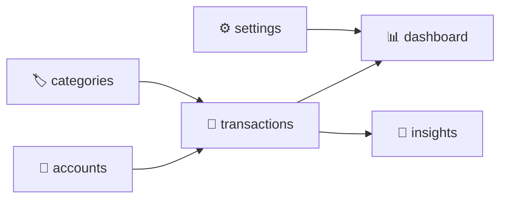

# 🏗️ Fase 2 — Arquitetura & DDD (versão enxuta)

> Abordagem **DDD-lite** para desenvolvedor solo: só o que resolve problemas reais.
> Status: Fase 2 e implementação do MVP em `mobile/` ✅ (ver testes: `npm test`)

---

## 1. Glossário (Linguagem Ubíqua)

Estes nomes valem para **stories, banco e código**. Mudou o termo aqui, muda em todo lugar.

| Termo (PT) | Nome no código | Definição | Stories |
|---|---|---|---|
| Transação | `Transaction` | Movimentação de dinheiro registrada em uma conta, em uma data. | US-001..006 |
| Gasto | `Transaction` com `type = 'expense'` | Transação que **diminui** o saldo da conta. | US-001 |
| Receita | `Transaction` com `type = 'income'` | Transação que **aumenta** o saldo da conta. | US-002 |
| Conta | `Account` | Local onde o dinheiro está (Nubank, Santander). Tem nome e saldo inicial. | US-007, 008 |
| Saldo inicial | `Account.initialBalance` | Dinheiro na conta no momento do cadastro. Nunca muda depois de definido. | US-007 |
| Saldo (da conta) | calculado | `saldo inicial + receitas − gastos` das transações da conta. **Nunca é guardado.** | US-008 |
| Saldo consolidado | calculado | Soma dos saldos de todas as contas ativas. | US-007.3 |
| Saldo do mês | calculado | `receitas do mês − gastos do mês` (todas as contas). Diferente do saldo da conta. | US-012 |
| Categoria | `Category` | Etiqueta que classifica uma transação. Tem nome, ícone, cor e tipo (gasto ou receita). | US-010, 011 |
| Categoria padrão | `Category.isDefault = true` | Criada pelo app na primeira abertura. Não pode ser excluída. | US-010 |
| Valor | `Money` | Quantia monetária, guardada em **centavos inteiros**. | todas |
| Meta mensal | `Settings.monthlyBudget` | Limite de gastos desejado por mês. Opcional. | US-019 |
| Arquivar | `archivedAt` preenchido | "Excluir" conta/categoria que já tem transações, escondendo-a sem apagar o histórico. | — |

---

## 2. Bounded Contexts (módulos)

Cada contexto vira **uma pasta** em `src/domains/`. Não são serviços separados.

| Contexto | Responsabilidade | Escreve dados? | Depende de |
|---|---|---|---|
| `accounts` | Cadastro de contas e cálculo do saldo | Sim | `transactions` (só leitura, para o saldo) |
| `categories` | Categorias padrão e personalizadas | Sim | — |
| `transactions` | CRUD de transações e suas validações | Sim | `accounts`, `categories` (por ID) |
| `dashboard` | Resumos e gráficos | **Não** (só leitura) | `transactions` |
| `insights` | IA: classificação, resumos, alertas | Não (só sugere) | `transactions`, `categories` |
| `settings` | Meta, tema, preferências | Sim | — |

### Decisões e porquês

| Decisão | Motivo |
|---|---|
| `accounts` e `transactions` **separados**, mas `accounts` lê as transações para calcular o saldo | Evita um módulo gigante, e o saldo continua com uma única fonte de verdade. |
| `dashboard` é **somente leitura** | Não tem regras de negócio, só consultas e agregações. Fica simples de testar. |
| Contextos se referenciam **por ID** (`accountId`, `categoryId`), nunca por objeto | Reduz o acoplamento. Mexer em Conta não quebra Transação. |
| Sem pasta `shared` gigante | Só `Money` e utilitários de data ficam em `src/shared`. |

---

## 3. Regras de Negócio

Cada regra tem ID para você citar nos testes e no código (`// RN-03`).

| ID | Regra |
|---|---|
| RN-01 | O valor de uma transação deve ser **maior que zero**. O sinal vem do `type`, não do número. |
| RN-02 | Valores são guardados em **centavos inteiros** (R$ 15,90 → `1590`), nunca como `float`. |
| RN-03 | Toda transação pertence a **exatamente uma conta** e **exatamente uma categoria**. |
| RN-04 | O tipo da categoria deve ser compatível com o tipo da transação (gasto só usa categoria de gasto). |
| RN-05 | O saldo da conta é **sempre calculado**, nunca armazenado. Editar ou excluir uma transação não exige "recalcular" nada. |
| RN-06 | A data da transação é "hoje" por padrão e pode ser passada. Datas futuras **não** são permitidas no MVP. |
| RN-07 | O nome da conta é único entre as contas ativas. O nome da categoria é único dentro do mesmo tipo. |
| RN-08 | Conta ou categoria com transações **não pode ser apagada**, só arquivada. Sem transações, pode ser apagada. |
| RN-09 | Categorias padrão não podem ser editadas nem excluídas. |
| RN-10 | Transação em conta ou categoria arquivada não pode ser **criada**. As existentes continuam visíveis. |
| RN-11 | O saldo inicial de uma conta não pode ser negativo (MVP). |

> [!NOTE]
> **RN-05 resolve a US-003.4 e a US-004.2.** Os critérios "o saldo da conta antiga é restaurado" e "o saldo é recalculado" ficam **automáticos**: se o saldo é uma consulta, não existe estado para ficar inconsistente.

---

## 4. Stories que estavam faltando

Lacunas achadas na revisão. Entram no backlog:

| Nova story | Resumo | Prioridade sugerida |
|---|---|---|
| US-021 | Editar nome de uma conta | 🟡 Should |
| US-022 | Arquivar/excluir conta (RN-08) | 🟡 Should |
| US-023 | Onboarding (1ª abertura: criar conta e saldo inicial) | 🔴 Must |
| US-024 | Editar/arquivar categoria personalizada | 🔵 Could |

> [!IMPORTANT]
> **A US-023 é Must.** O fluxo da Fase 1 diz que o app só funciona depois de existir ao menos uma conta, e nenhuma story do MVP cobria isso. Isso mostra por que revisar stories antes de codar vale a pena.

---

## 5. Próximos passos

- [ ] Passo 3: Modelo de domínio em TypeScript (`Money`, `Account`, `Category`, `Transaction`)
- [ ] Passo 4: Regras como funções puras com testes
- [ ] Passo 5: Diagrama ER (SQLite)
- [ ] Passo 6: ADR de banco de dados
- [ ] Passo 7: Estrutura de pastas e camadas
