# 🧠 Smart Wallet — Project Kickoff

## Visão Geral

**Smart Wallet** é um aplicativo mobile de controle de gastos pessoais, projetado para pessoas que utilizam múltiplos bancos e não conseguem ter uma visão unificada das suas finanças.

> [!NOTE]
> Este documento é o ponto de partida do projeto. Ele será atualizado conforme avançamos em cada fase.

---

## 🎯 Problema

| Dor | Impacto |
|-----|---------|
| Gastos pulverizados em múltiplos bancos (Nubank, Santander) | Sem visão consolidada |
| Não sabe para onde o dinheiro vai | Sem controle financeiro |
| Dificuldade de categorizar gastos | Sem insights para decisões |
| Falta de hábito de registro | Precisa ser simples e rápido |

---

## 👤 Persona Principal

**Eduardo** — Cientista de Dados / Estudante de Eng. Software
- 🏦 Usa Nubank e Santander
- 📱 Registra gastos manualmente (inicialmente)
- 🎯 Quer entender padrões de consumo
- 🤖 Valoriza insights inteligentes (IA)
- 📊 Gosta de visualizações de dados

---

## 🛤️ Roadmap Completo (8 Fases)

```mermaid
graph LR
    F1["🔍 Fase 1\nDiscovery &\nUser Stories"] --> F2["🏗️ Fase 2\nArquitetura &\nDDD"]
    F2 --> F3["🎨 Fase 3\nDesign System\n& UI/UX"]
    F3 --> F4["⚙️ Fase 4\nSetup &\nFundação"]
    F4 --> F5["💻 Fase 5\nDesenvolvimento\nCore"]
    F5 --> F6["🤖 Fase 6\nAI &\nInsights"]
    F6 --> F7["🧪 Fase 7\nTestes &\nQualidade"]
    F7 --> F8["🚀 Fase 8\nDeploy &\nPublicação"]

    style F1 fill:#10B981,stroke:#059669,color:#fff
    style F2 fill:#6366F1,stroke:#4F46E5,color:#fff
    style F3 fill:#F59E0B,stroke:#D97706,color:#fff
    style F4 fill:#3B82F6,stroke:#2563EB,color:#fff
    style F5 fill:#EF4444,stroke:#DC2626,color:#fff
    style F6 fill:#8B5CF6,stroke:#7C3AED,color:#fff
    style F7 fill:#14B8A6,stroke:#0D9488,color:#fff
    style F8 fill:#F43F5E,stroke:#E11D48,color:#fff
```

---

### Fase 1 — 🔍 Discovery & User Stories `← ESTAMOS AQUI`
> **O que vamos aprender:** Como levantar requisitos, escrever User Stories no formato correto, definir critérios de aceitação e priorizar com MoSCoW.

| Entregável | Descrição |
|-----------|-----------|
| Mapa de funcionalidades | Features organizadas por domínio |
| User Stories | Histórias no formato "Como [persona], quero [ação], para [benefício]" |
| Critérios de aceitação | Condições para considerar a story "pronta" |
| Priorização MoSCoW | Must / Should / Could / Won't para o MVP |

---

### Fase 2 — 🏗️ Arquitetura & DDD
> **O que vamos aprender:** Domain-Driven Design, Bounded Contexts, Aggregates, Entities, Value Objects, modelagem de banco de dados.

| Entregável | Descrição |
|-----------|-----------|
| Mapa de domínios (Bounded Contexts) | Separação lógica do sistema |
| Modelo de domínio | Entities, Value Objects, Aggregates |
| Diagrama ER | Modelagem relacional do banco |
| Decisão de banco de dados | SQLite local vs Cloud (Supabase/Firebase) |
| Arquitetura do app | Camadas, pastas, padrões |

---

### Fase 3 — 🎨 Design System & UI/UX
> **O que vamos aprender:** Design tokens, sistema de cores, tipografia, componentes reutilizáveis, wireframes e protótipos.

| Entregável | Descrição |
|-----------|-----------|
| Design Tokens | Cores, espaçamentos, fontes, sombras |
| Wireframes | Fluxos de tela low-fidelity |
| Protótipo visual | Telas high-fidelity |
| Component Library | Catálogo de componentes |

---

### Fase 4 — ⚙️ Setup & Fundação
> **O que vamos aprender:** Configurar React Native (Expo), ESLint, TypeScript, estrutura de pastas, CI/CD.

| Entregável | Descrição |
|-----------|-----------|
| Projeto React Native (Expo) | Scaffold com TypeScript |
| Estrutura de pastas DDD | Organização por domínio |
| Configuração de qualidade | ESLint, Prettier, Husky |
| Navegação base | React Navigation configurada |

---

### Fase 5 — 💻 Desenvolvimento Core
> **O que vamos aprender:** CRUD, state management, persistência local, navegação, formulários, validação.

| Entregável | Descrição |
|-----------|-----------|
| Registro de transações | Adicionar, editar, excluir gastos |
| Categorização | Sistema de categorias com ícones |
| Dashboard | Resumo mensal com gráficos |
| Multi-banco | Gerenciar contas de diferentes bancos |
| Filtros e buscas | Por período, categoria, banco |

---

### Fase 6 — 🤖 AI & Insights
> **O que vamos aprender:** Integração com LLMs, análise de padrões, classificação automática.

| Entregável | Descrição |
|-----------|-----------|
| Classificação automática | IA sugere categoria do gasto |
| Insights mensais | "Você gastou 40% mais em delivery este mês" |
| Previsões | Estimativa de gasto até final do mês |
| Alertas inteligentes | "Atenção: padrão de gasto incomum detectado" |

---

### Fase 7 — 🧪 Testes & Qualidade
> **O que vamos aprender:** Testes unitários, de integração, E2E, code coverage.

| Entregável | Descrição |
|-----------|-----------|
| Testes unitários | Jest + Testing Library |
| Testes E2E | Detox ou Maestro |
| Code coverage | Mínimo 80% |
| Performance | Profiling e otimização |

---

### Fase 8 — 🚀 Deploy & Publicação
> **O que vamos aprender:** Build de produção, assinatura de app, screenshots, ASO, publicação nas lojas.

| Entregável | Descrição |
|-----------|-----------|
| Build iOS | via EAS Build (Expo) |
| Build Android | APK/AAB assinado |
| App Store | Conta Apple Developer + submissão |
| Play Store | Conta Google Play + submissão |
| ASO | App Store Optimization (título, descrição, screenshots) |

---

## 🧰 Tech Stack Definida

| Camada | Tecnologia | Motivo |
|--------|-----------|--------|
| **Mobile** | React Native + Expo | Cross-platform, JS/TS, grande ecossistema |
| **Linguagem** | TypeScript | Type-safety, melhor DX |
| **Navegação** | Expo Router | File-based routing moderno |
| **State** | Zustand | Simples, performático |
| **Banco Local** | SQLite (expo-sqlite) | Offline-first, relacional |
| **Gráficos** | Victory Native ou react-native-chart-kit | Visualizações bonitas |
| **IA** | Google Gemini API | Classificação e insights |
| **Build/Deploy** | EAS (Expo Application Services) | Build na nuvem, OTA updates |
| **Testes** | Jest + React Native Testing Library | Padrão do ecossistema |

---

## ✅ Próximo Passo

**Iniciar a Fase 1: Discovery & User Stories**

Vamos criar o mapa completo de funcionalidades e escrever as User Stories com critérios de aceitação. Isso vai ser a base de TUDO que vem depois.

> [!IMPORTANT]
> Nenhuma linha de código será escrita antes de termos clareza total sobre O QUE estamos construindo e PARA QUEM. Isso é o que separa engenharia de software de "programação por tentativa e erro".
